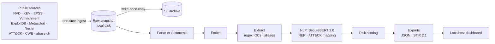

# Cyber Threat Intelligence System

A threat intelligence pipeline that collects vulnerability and indicator-of-compromise (IOC)
data from public sources, enriches and prioritizes it, and presents it in a local analyst
dashboard.

> **Status: in development.** The project is being built in phases. See the
> [build plan](tasks/todo.md) for scope and progress. Sections marked *planned* describe
> work that is not implemented yet.

## The problem

Security teams face tens of thousands of new CVEs and a constant stream of IOCs every
year. Severity scores alone don't say what to fix first: most "high" and "critical"
vulnerabilities are never exploited. This project answers a practical analyst question:
**which threats deserve attention first, and why?**

## What it does

- **Collects** CVEs (NVD), known-exploited vulnerabilities (CISA KEV), exploit-likelihood
  scores (FIRST EPSS), public exploits (ExploitDB), attacker techniques (MITRE ATT&CK),
  weakness types (MITRE CWE), CISA SSVC triage (Vulnrichment), weaponized exploits
  (Metasploit, Nuclei), and IOCs (abuse.ch ThreatFox and URLhaus), all in a single
  reproducible ingest.
- **Enriches** each CVE with exploit availability, KEV status, EPSS, CWE, and the content
  of its reference pages, fetched with an SSRF-safe scraper.
- **Extracts IOCs and observables** (IPs, domains, URLs, file hashes, CVE IDs, CVSS
  vectors) from advisory and threat-report text with validated, defang-aware regexes, and
  normalizes threat-actor and malware names (APT28 = Fancy Bear = Sednit) to MITRE ATT&CK
  IDs (alias matching is not yet evaluated).
- **Understands text** with SecureBERT 2.0, a cybersecurity language model: extracts
  malware, products, and organizations, and maps CVEs to ATT&CK techniques.
- **Prioritizes** vulnerabilities with a risk score evaluated forward in time against CISA
  KEV additions, with rank-based tiers whose hit rates fall monotonically.
- **Presents** the results in a local, read-only analyst dashboard (eight views, three
  relationship graphs) served on 127.0.0.1 under a strict Content-Security-Policy.
  STIX 2.1 output is *planned*.

## Architecture



Ingest, snapshot, parse, S3 upload, enrichment (per-CVE join, reference-page cleaning),
IOC/alias extraction, SecureBERT 2.0 NER and embeddings, graded ATT&CK mapping, and a
pre-registered CWE classification and risk-scoring evaluations, and the local dashboard
are built; STIX 2.1 output is *planned*.

- [Architecture](docs/architecture.md): stages, storage layout, point-in-time data,
  security boundaries.
- [Data sources](docs/data-sources.md): every source, why it is ingested, and corpus size.
- [Design decisions](docs/decisions.md): why each choice was made and what it costs,
  e.g. why S3 is a write-once archive rather than the pipeline's working store.

## Results so far

### IOC extraction

IOC and observable extraction over the 2026-10-26 snapshot (1,280 cleaned reference pages
and 168,393 NVD descriptions). Every number below comes from `cti extract` and
`cti extract-eval --labels data/reference/ioc-review-2026-10-26.csv`.

| Measure | Result |
|---|---|
| Observables from reference pages | 25,684: CVE IDs 14,433 · SHA-256 4,658 · URLs 2,330 · CVSS vectors 1,594 · IPv4 1,446 · domains 935 · SHA-1 124 · MD5 111 · IPv6 53 |
| Precision, reference pages | 98.5% (approx. 95% CI 88.6–100%) |
| Precision, NVD descriptions | 89.1% (approx. 95% CI 81.3–96.8%) |
| Weakest strata | NVD IPv4 1/12 (version lists such as `11.0.32.1` look like addresses) · NVD MD5 0/5 (keys and IVs) · page SHA-1 7/11 · page MD5 9/11 |

How to read this:

- **Sample.** 200 extracted items, about 12 per (type × origin) stratum, drawn
  reproducibly (seeded hash order). Labels were made by an AI assistant (Claude) under a
  written criterion, and are committed for review. "Correct" means the span really is a
  value of that type (an address, hostname, URL, or digest), not that it is malicious.
- **Weighting.** Each precision weights strata by their size, so CVE IDs (56% of page
  items) dominate the page figure. Intervals are approximate: a normal interval with
  Agresti-Coull variance per stratum.
- **Counts.** These are observables, not all threats. They include benign hosts
  (vendor sites, `127.0.0.1`), and NVD-origin items are left out of headline IOC counts.
- **Gold set.** It is rule-generated, so it only checks agreement: CVE IDs 59/59 (mostly
  each record's own ID) and domains 132/140 (spans from an older regex). It is not an
  accuracy claim; see [`vault/ioc-extraction.md`](vault/ioc-extraction.md).

### CVE → ATT&CK technique mapping

Graded against MITRE CTID's expert mappings of KEV CVEs to ATT&CK (ATT&CK 16.1,
remapped to v20). The split is by time: test = the 135 mapped CVEs in our NVD data
(published 2024+), dev = the 284 older ones. Test is graded on how each CVE is exploited
(`exploitation_technique`, 132 CVEs). Each method ranks 227 parent techniques from the
CVE's NVD description. From `cti attack-eval`:

| Method | hit@5 (95% CI) | vs majority, paired (95% CI) |
|---|---|---|
| Majority (most common labels on dev) | 0.41 (0.33–0.50) | — |
| TF-IDF similarity | 0.14 (0.08–0.20) | −0.27 |
| SecureBERT 2.0 bi-encoder similarity | 0.20 (0.13–0.27) | −0.21 |
| Label prior + TF-IDF | 0.43 (0.35–0.52) | +0.02 (0.00–0.05) |
| **Label prior + SecureBERT 2.0 bi-encoder** | **0.57 (0.48–0.65)** | **+0.16 (0.10–0.23)** |

- **Similarity alone loses to the trivial baseline.** CVE text describes the bug,
  while technique text describes attacker behaviour, and two techniques (T1190, T1068)
  account for half the test CVEs.
- **What the combination fixes.** The gain comes almost entirely from one shift over time.
  T1068 (privilege escalation) is rare among older KEV CVEs (8 of 300 dev labels) but
  common in 2024+ ones (32 of 160). Text similarity pulls it into the top 5 when a
  description says so: 17 of the 22 CVEs the combination wins over majority (it loses 1).
- **Limits.** There is no gain at rank 1 (hit@1 0.26, the same as majority). On dev the
  combination only matches majority (+0.01, CI −0.01 to 0.04).
- **β sensitivity.** The prior weight β was chosen on dev, which cannot separate the
  values 0.1–1.0. On test, β = 0.5 or 1.0 would give no gain, and TF-IDF at β = 0.02
  would match the bi-encoder (0.58). So the robust finding is "label prior + text
  similarity corrects a time-shifted prior", not "SecureBERT beats keywords".
- **Disclosures.** The combined method and its β grid were written after the
  similarity-only test results were seen. β is picked on KEV text and applied to NVD
  text. Every graded CVE is in KEV, so the scores don't generalize to all CVEs. These
  diagnostics are written by `cti attack-eval` (`diagnostics` in its output); details in
  [`vault/attack-mapping.md`](vault/attack-mapping.md).

#### Re-evaluation on a fresh test set (pre-registered, Phase 10b)

The test split above is spent, so all 419 KEV mappings became training data and the
methods were re-tested once on CTID's separate `attack_to_cve` mappings (200 non-KEV
CVEs from 2008–2020 with an exploitation label). Every choice was committed in
`src/cti/nlp/attack2_config.py` before any test score. From `cti attack-eval2`:

| Method | hit@1 | hit@5 (95% CI) |
|---|---|---|
| Majority | 0.26 | 0.69 (0.62–0.75) |
| Label prior + bi-encoder (Phase 5b method) | 0.26 | 0.69 |
| **Combiner** (prior, bi-encoder, TF-IDF, CWE→CAPEC→ATT&CK paths, CVSS rule) | **0.29** | **0.72 (0.66–0.78)** |
| CTID methodology replay (reference only) | 0.56 | 0.82 |

- **Pre-registered decision: passes, narrowly.** Combiner minus the Phase 5b method:
  hit@5 +0.035 (95% CI +0.005 to +0.070). Cross-validation set the prior weight so high
  that the Phase 5b method equals majority here.
- **Where the gain comes from:** a CVSS heuristic (user interaction → drive-by /
  user execution), mostly at T1189. It was written after the test label counts were
  seen, which is disclosed; without it the gain is +0.015 and not significant. The
  CWE→CAPEC→ATT&CK chain adds nothing, and text similarity alone is weak on this set.
- **Replay** of CTID's own vulnerability-type rules scores far higher, which shows how much
  the labels follow that method; it is a reference row, not a competitor. Details:
  [`vault/attack-mapping-v2-results.md`](vault/attack-mapping-v2-results.md).

### CWE classification of CVE descriptions

Each 2024+ CVE description with a usable CWE label is classified into one of 118 CWE
weakness classes (plus "other"). Labels are the human-assigned CWEs: from NVD, else the
CVE's CNA, else CISA's Vulnrichment. The split is by time: train on 2024–2025, choose
settings on dev (2026-01-01 to 2026-04-29), and test once on the 51,243 later single-label
CVEs. Every choice was committed before any test score existed
(`src/cti/nlp/cwe_config.py`). The headline uses the test CVEs whose description does
**not** contain the CWE's name, because 26–30% do. From `cti cwe-eval`:

| Method (test, name absent, n = 37,794) | macro-F1 (95% CI) | top-1 | top-5 |
|---|---|---|---|
| Majority class | 0.002 | 0.10 | 0.29 |
| **TF-IDF + logistic regression** | **0.394 (0.382–0.402)** | 0.56 | 0.84 |
| SecureBERT 2.0 embeddings + logistic regression | 0.265 (0.257–0.272) | 0.44 | 0.75 |
| Nearest centroid on the embeddings | 0.137 | 0.20 | 0.46 |

- **Frozen SecureBERT sentence embeddings lose to TF-IDF** by 0.13 macro-F1 (paired 95% CI
  −0.14 to −0.12). A likely reason, not tested here: the bi-encoder is trained for
  similarity search, and mean pooling may blur the specific bug terms a linear model on
  words keeps. Published work fine-tunes a transformer instead (e.g.
  [V2W-BERT](https://arxiv.org/abs/2102.11498)); that was out of scope for CPU-only compute.
- **Name leakage is real.** When the description names the CWE, TF-IDF scores 0.92.
- **Both chosen regularization values sit at an edge of their pre-registered grids**, so
  slightly better settings may exist. They were not explored after the fact.
- **Scores sit below published top-1 accuracy** (roughly 70–88% in work such as
  [V2W-BERT](https://arxiv.org/abs/2102.11498) and
  [ThreatZoom](https://arxiv.org/abs/2009.11501), not measured here). The likely reasons are
  the time split, a test set labelled mostly by CNAs, the name-absent stratum, and
  macro-averaging over 118 classes.
- **How to read the metrics.** Macro-F1 excludes "other"; top-1/top-5 count a correct
  "other" (8.8% of test) as a hit. Intervals are percentile bootstraps over CVEs.
- **The gold set is circular.** On the rule-generated gold set, predicting from the
  source feed alone scores 0.996, the same as TF-IDF, because its labels were generated
  from the source. Its 50 ThreatFox documents are left out, because abuse.ch's terms
  forbid training models on their data.

Details: [`vault/cwe-classification.md`](vault/cwe-classification.md).

### Forward-looking risk scoring (predicting CISA KEV additions)

Can data known on a given day predict which CVEs CISA will add to its Known Exploited
Vulnerabilities catalog in the next 180 days? Each CVE is scored only with what was known
at a cutoff: EPSS that day, CISA's SSVC decision at that day's commit, ExploitDB /
Metasploit / Nuclei at that day's commit, and age. Four cutoffs 180 days apart give three
rolling test folds (2025-05-04, 2025-10-31, 2026-04-29), each trained only on earlier
windows: 231,304 CVE-fold rows, **68 KEV additions**. Population: CVEs published from
2024-01-01 and not yet in KEV. Every choice, including the decision rule, was committed
before any test score (`src/cti/nlp/risk_config.py`, commit `c528d07`). From
`cti risk-eval`:

| Method (3 test folds pooled, 68 positives) | Caught in top 100 per fold | Top 1% per fold | Mean AP |
|---|---|---|---|
| Random (expected) | 0.1 | 0.7 | — |
| CNA CVSS *(snapshot-time, biased; illustration)* | 1.2 | 7.1 | 0.002 |
| SSVC rule (active > poc > none, then EPSS) | 2 | 14 | 0.009 |
| EPSS at the cutoff | 2 | 15 | 0.015 |
| **Logistic regression (pre-registered headline)** | **6** (recall 0.09, 95% CI 0.04–0.18) | 16 | 0.011 |
| Gradient boosting (challenger) | 8 | 15 | 0.012 |

- **Pre-registered verdict (pooled over the 3 folds): the model beats EPSS at a 100-CVE
  budget**, +4 hits (paired bootstrap 95% CI +1 to +8). Per fold (2025-05 / 2025-10 /
  2026-04): logistic 1 / 3 / 2, EPSS 1 / 1 / 0, so the margin comes from two folds.
  It **doesn't hold at the 1% budget** (+1, CI −6 to +9), and EPSS has the higher mean
  average precision. The boosting challenger: +6 vs EPSS (CI +1 to +12, secondary).
- **Most additions aren't predictable from these signals.** Each method's top 1% catches
  14–16 of the 68 (23 if the logistic and EPSS lists are combined).
- **Tier hit rates fall monotonically.** Top 0.1% ("critical"): 6 of 230 added to KEV
  (2.6%, 95% CI 1.2–5.6%; about 90× the overall 0.029% rate); then 0.48%, 0.17%, and
  0.016% for the rest, as pre-registered.
- **Exploratory, read after scoring (no CIs):**
  - EPSS ranked the latest fold poorly (ROC-AUC 0.41). Its 17 additions had a median
    EPSS percentile of 0.16 (16 scored, 1 unscored).
  - The largest standardized weights (last fold only) are recency (−0.70), SSVC "total"
    technical impact (0.64) and EPSS (0.63).
  - Without EPSS the model catches 9 in the top 100; its mean AP of 0.033 comes mostly
    from the latest fold (0.072). Without SSVC: 6 in the top 100, 18 in the top 1%.
  - SecureBERT description text adds nothing at 100 and catches 20 vs 16 at 500, the
    same when CVEs with "exploited in the wild" wording are dropped (246 test rows, 1
    positive).
- **Limits.** 68 positives: one hit is 1.5 points of recall. KEV covers only part of real
  exploitation and leans to enterprise vendors, so this predicts "what CISA lists". The
  last window is 177 days (it ends at the catalog's 2026-10-23 release). EPSS v3 at
  cutoff4 (training only); v4 at every test cutoff.

Details: [`vault/risk-eval.md`](vault/risk-eval.md).

### SecureBERT 2.0 NER (sanity check)

`cti ner` tags 1,280 reference pages (10 min on CPU). On the rule-generated gold set
(`cti ner-eval`, text-derived spans), overlap recall is Indicator 1.00, Malware 0.78,
Organization 0.29, System 0.26. Precision is only a lower bound there, because the gold
set labels a fraction of what is in each text. On scraped pages (code, tables, logs) the
model is noisy, so displays use spans scoring ≥ 0.9 or linked to an ATT&CK/ThreatFox name.
See [`vault/nlp-design.md`](vault/nlp-design.md).

## Analyst dashboard

`cti export` turns the pipeline's outputs into schema-validated JSON, and `cti serve`
serves a Vite + React dashboard over it on 127.0.0.1 only. Eight views:

| View | What an analyst gets |
|---|---|
| Overview | The question and how the two linked lists (vulnerabilities, threats) answer it, headline numbers, tier sizes with historical KEV rates, top of the queue, a plain-language guide to every tab (what, why, how it's calculated), and every disclosure |
| Risk queue | The critical, high and elevated tiers: sortable, filterable, with each CVE's per-feature contribution to its rank and any linked malware families |
| Threats | Malware and tool families ranked by a pre-declared heuristic (linked KEV CVEs, ransomware, indicator growth), each with its reason, category, ATT&CK techniques and linked CVEs with review state |
| Risk landscape | Model rank vs EPSS percentile, model weights (refit vs evaluated), signal coverage by tier, tiered CVEs by month |
| Weakness graph | CWE pillar → CWE → critical/high CVE, click to trace |
| ATT&CK graph | KEV CVE → technique → tactic from MITRE CTID's expert mappings, by mapping type |
| Indicators | Defanged indicator strings from CVE references, a shared-host graph, abuse.ch aggregates |
| Evaluation | The pre-registered decision, recall with CIs against EPSS and baselines, per-fold hits, other pipeline results, limitations |

Honest by construction: rank and tier only (no fake probabilities), tier hit rates
labelled as historical, context fields marked as never used by the model, and every
result read from the export (only fixed design constants, such as the tier bands, are in
the code).

Secure by construction:
- **Server:** loopback only, with an exact-match file allowlist built at startup. Host
  headers other than `127.0.0.1` or `localhost` are rejected (DNS-rebinding defense).
- **Browser policy:** a strict CSP sent as an HTTP header (`script-src 'self'`, no inline
  code, no remote origins, Trusted Types), plus security headers on every response,
  errors included.
- **Indicator display:** indicators are defanged in Python and rendered as text, never as
  links.
- **Supply chain:** npm packages are pinned exactly and at least 14 days old, installed
  without install scripts, and signature-verified in CI.
- **CI:** builds against a synthetic fixture and loads every view in headless Chrome,
  failing on any CSP violation or console error.

## Security skills and tools

| Area | Skills | Tools |
|---|---|---|
| Threat intelligence | CVE/KEV/EPSS analysis, IOC extraction and defanging, threat-actor alias normalization, MITRE ATT&CK mapping, STIX 2.1 | NVD, CISA KEV, FIRST EPSS, MITRE ATT&CK/CWE, abuse.ch, tldextract (Public Suffix List) |
| Vulnerability management | Risk-based prioritization, forward-looking evaluation | Python, pandas, scikit-learn |
| Secure engineering | SSRF defense, secrets management, least-privilege IAM, threat modeling (STRIDE) | httpx, pydantic, GitHub Actions, pip-audit, secret scanning |
| Cloud security | Private, encrypted, TLS-only storage; cost guardrails | AWS S3, IAM, AWS Budgets |
| NLP / ML | Security-domain NER and embeddings, supervised-prior + embedding ranking, baselines, paired bootstrap evaluation, leakage control, boilerplate removal on untrusted HTML | SecureBERT 2.0 (ModernBERT), PyTorch, Hugging Face Transformers, scikit-learn, NumPy, trafilatura, lxml |
| ML supply chain | Model pinning by commit and weight hash, safetensors only, no remote code, offline inference | Hugging Face Hub, safetensors |
| Visualization | Analyst dashboard, relationship graphs, honest uncertainty display | Vite, React, TypeScript, hand-rolled SVG |
| Web security | Strict CSP sent as HTTP headers, DNS-rebinding defense, allowlist static serving, supply-chain hygiene | Python stdlib `http.server`, npm lockfile + signature audit |

## Design principles

- **Ingest once.** A single, auditable data pull. Everything downstream is reproducible
  from the stored snapshot without touching the network again.
- **Low cost.** S3 is the only cloud service; all compute runs locally.
- **Honest metrics.** Every reported number is produced by a script in this repo, next to
  the baselines it should beat.
- **Safe handling of malicious data.** IOCs are defanged, and the scraper refuses
  internal and cloud-metadata addresses.
- **Responsible data use.** Raw feed data is never redistributed; feed terms of use are
  respected.

## Setup

Requirements: Python 3.12+, Node.js 20.19+ (dashboard), an AWS account (S3 only), and a
free abuse.ch Auth-Key.

```bash
python3 -m venv .venv && source .venv/bin/activate
pip install -c requirements.lock -e '.[dev,enrich,ml]'
cp .env.example .env   # fill in values; .env is gitignored
pytest                 # offline: no network or AWS access needed
ruff check .
```

SecureBERT 2.0 (CPU, ~1.2 GB of weights) runs in a separate environment so torch never
enters the main lock:

```bash
python3 -m venv .venv-nlp
.venv-nlp/bin/pip install -c requirements-nlp.lock -e '.[dev,enrich,ml,nlp]'
.venv-nlp/bin/cti models fetch   # one-time download at pinned revisions; then offline
```

## Usage

```bash
cti probe                       # cheap check that every source is reachable / keys work
cti ingest --date 2026-10-25    # the one-time fetch into data/snapshots/<date>/
cti ingest --date 2026-10-25 --resume                       # continue after a failure
cti ingest --date 2026-10-25 --refetch kev --reason "..."   # logged, keeps old copy
cti ingest --date 2026-10-25 --refetch epss --new-dates-only --reason "..."  # add cutoffs
cti status --date 2026-10-25    # manifest: files, sizes, pinned versions, refetches
cti fetch-nvd-archive          # NVD 2002-2022 for Phase 10b -> data/reference-snapshots/ (never uploaded)
cti threats-sheet --date 2026-10-26  # blank blind-review sheet of the top ThreatFox families
cti threats-sheet --date 2026-10-26 --priority  # add unlabelled families from the priority top 20
cti threats --date 2026-10-26  # threat catalog: categories, ATT&CK techniques, CVE links, priority
cti parse  --date 2026-10-25    # offline: raw snapshot -> data/processed/<date>/*.jsonl.gz
cti enrich --date 2026-10-25    # offline: per-CVE join + cleaned reference pages -> data/enriched/<date>/
cti extract --date 2026-10-25   # offline: regex IOCs + alias mentions -> data/extracted/<date>/
cti extract-eval --date 2026-10-25 --labels data/reference/ioc-review-2026-10-26.csv  # precision
cti models verify                   # weights match their pinned SHA-256 (nlp env)
cti attack-eval --date 2026-10-25   # grade CVE -> ATT&CK ranking on MITRE CTID's KEV mappings
.venv-nlp/bin/cti attack-eval2 --date 2026-10-26 --archive-date 2026-10-29  # pre-registered re-evaluation (10b)
cti ner --date 2026-10-25           # SecureBERT NER over the reference pages (~10 min CPU)
cti ner-eval --date 2026-10-25      # NER sanity check on the gold set
cti embed --date 2026-10-25         # bi-encoder embeddings of NVD descriptions (~50 min CPU)
cti embed --date 2026-10-25 --cwe-id-masked   # re-embed descriptions with literal CWE IDs masked
cti cwe-eval --date 2026-10-25      # CWE classification: TF-IDF vs SecureBERT vs baselines (~8 min)
cti risk-eval --date 2026-10-25     # forward-looking KEV prediction, rolling-origin folds (~30 s)
cti export --date 2026-10-25        # dashboard JSON into data/export/<date>/ (~10 s)
# threats need the export's risk tiers: cti export -> cti threats -> cti export
(cd web && npm ci && npm run build) # build the dashboard once (pinned, no install scripts)
cti serve                           # dashboard at http://127.0.0.1:8000/ (local only)
cti serve --export-dir web/fixtures # the same dashboard on synthetic data (no pipeline run)
cti upload --date 2026-10-25 --gold  # write-once copy to S3 (checksums verified)
cti gold-import --gold ... --entities ... --corpus ...  # one-time: freeze the gold set
```

One-time AWS setup (budget alert, hardened bucket, least-privilege `cti` user):
[`infra/README.md`](infra/README.md).

## Project layout

```
src/cti/
  config.py          typed settings from CTI_* env vars; fail fast on missing values
  models.py          Document: the normalized record every source produces
  snapshot.py        immutable raw snapshot + manifest (ingest runs once)
  http/
    client.py        retrying HTTP client (429/5xx only, Retry-After aware)
    ratelimit.py     sliding-window rate limiter
    safe_fetch.py    SSRF-safe fetcher for untrusted URLs
  storage/           local, S3, and mirrored backends (no delete operation)
  sources/           one module per feed: fetch raw (network) + parse (offline)
  ingest.py, cli.py  one-time ingest orchestration and the `cti` command
  upload.py          write-once, checksum-verified copy of a snapshot to S3
  enrich/            per-CVE join with leakage-safe point-in-time features; CWE lookup;
                     reference-page cleaning (boilerplate removal, JS-shell detection)
  nlp/               regex IOC extraction, alias normalizer, extraction evaluation,
                     ATT&CK technique ranking graded on MITRE CTID mappings,
                     pinned SecureBERT 2.0 models (NER, bi-encoder embeddings)
  dashboard/         `cti export` (schema-validated dashboard JSON) and `cti serve`
                     (allowlist static server on 127.0.0.1, strict security headers)
web/                 Vite + React + TypeScript dashboard (7 views, hand-rolled SVG charts),
                     synthetic fixture, static and headless-browser checks
  defang.py          make IOCs non-clickable (hxxp, fxp, [.]) and undo common defang forms
  references/        reference-link classifier, page selection, polite SSRF-safe scraper
  gold.py            frozen, checksummed evaluation gold set
tests/unit/          offline unit tests
docs/                architecture, design decisions, data sources
infra/               AWS policy templates + one-time setup steps
vault/               design notes
tasks/todo.md        build plan and progress
```

## What this project demonstrates

- Turning raw threat feeds into **prioritized, explainable** intelligence.
- **Secure-by-design** engineering: SSRF protection, least-privilege cloud access, secret
  hygiene, and a documented threat model.
- **Measurement discipline**: risk scores evaluated against real exploitation outcomes,
  not assumed.
- Building **end to end**: ingestion, processing, cloud storage, evaluation, and UI.
