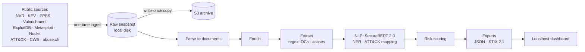

# Cyber Threat Intelligence System

A threat intelligence pipeline that collects vulnerability and indicator-of-compromise (IOC)
data from public sources, enriches and prioritizes it, and presents it in a local analyst
dashboard.

> **Status: in development.** The project is being built in phases. See the
> [build plan](tasks/todo.md) for scope and progress. Sections marked *planned* describe
> work that is not implemented yet.

## The problem

Security teams face tens of thousands of new CVEs and a constant stream of IOCs every
year. Severity scores alone don't say what to fix first: most "high" and "critical"
vulnerabilities are never exploited. This project answers a practical analyst question:
**which threats deserve attention first, and why?**

## What it does

- **Collects** CVEs (NVD), known-exploited vulnerabilities (CISA KEV), exploit-likelihood
  scores (FIRST EPSS), public exploits (ExploitDB), attacker techniques (MITRE ATT&CK),
  weakness types (MITRE CWE), CISA SSVC triage (Vulnrichment), weaponized exploits
  (Metasploit, Nuclei), and IOCs (abuse.ch ThreatFox and URLhaus), all in a single
  reproducible ingest.
- **Enriches** each CVE with exploit availability, KEV status, EPSS, CWE, and the content
  of its reference pages, fetched with an SSRF-safe scraper.
- **Extracts IOCs and observables** (IPs, domains, URLs, file hashes, CVE IDs, CVSS
  vectors) from advisory and threat-report text with validated, defang-aware regexes, and
  normalizes threat-actor and malware names (APT28 = Fancy Bear = Sednit) to MITRE ATT&CK
  IDs (alias matching is not yet evaluated).
- *(planned)* **Understands text** with SecureBERT 2.0, a cybersecurity language model: extracts
  malware, products, and organizations, and maps CVEs to ATT&CK techniques.
- *(planned)* **Prioritizes** vulnerabilities with a risk score validated against real-world
  exploitation, so the top tier is small and meaningful.
- *(planned)* **Presents** the results in a localhost Next.js dashboard and as STIX 2.1 output.

## Architecture



Ingest, snapshot, parse, S3 upload, enrichment (per-CVE join, reference-page cleaning),
and IOC/alias extraction are built; SecureBERT NER, ATT&CK mapping, and scoring are
*planned*.

- [Architecture](docs/architecture.md): stages, storage layout, point-in-time data,
  security boundaries.
- [Data sources](docs/data-sources.md): every source, why it is ingested, and corpus size.
- [Design decisions](docs/decisions.md): why each choice was made and what it costs,
  e.g. why S3 is a write-once archive rather than the pipeline's working store.

## Results so far

### IOC extraction

IOC and observable extraction over the 2026-10-26 snapshot (1,280 cleaned reference pages
and 168,393 NVD descriptions). Every number below comes from `cti extract` and
`cti extract-eval --labels data/reference/ioc-review-2026-10-26.csv`.

| Measure | Result |
|---|---|
| Observables from reference pages | 25,684: CVE IDs 14,433 · SHA-256 4,658 · URLs 2,330 · CVSS vectors 1,594 · IPv4 1,446 · domains 935 · SHA-1 124 · MD5 111 · IPv6 53 |
| Precision, reference pages | 98.5% (approx. 95% CI 88.6–100%) |
| Precision, NVD descriptions | 89.1% (approx. 95% CI 81.3–96.8%) |
| Weakest strata | NVD IPv4 1/12 (version lists such as `11.0.32.1` look like addresses) · NVD MD5 0/5 (keys and IVs) · page SHA-1 7/11 · page MD5 9/11 |

How to read this:

- **Sample.** 200 extracted items, about 12 per (type × origin) stratum, drawn
  reproducibly (seeded hash order). Labels were made by an AI assistant (Claude) under a
  written criterion, and are committed for review. "Correct" means the span really is a
  value of that type (an address, hostname, URL, or digest), not that it is malicious.
- **Weighting.** Each precision weights strata by their size, so CVE IDs (56% of page
  items) dominate the page figure. Intervals are approximate: a normal interval with
  Agresti-Coull variance per stratum.
- **Counts.** These are observables, not all threats. They include benign hosts
  (vendor sites, `127.0.0.1`), and NVD-origin items are left out of headline IOC counts.
- **Gold set.** It is rule-generated, so it only checks agreement: CVE IDs 59/59 (mostly
  each record's own ID) and domains 132/140 (spans from an older regex). It is not an
  accuracy claim; see [`vault/ioc-extraction.md`](vault/ioc-extraction.md).

### CVE → ATT&CK technique mapping (baselines)

Graded against MITRE CTID's expert mappings of KEV CVEs to ATT&CK (ATT&CK 16.1,
remapped to v20). Test = the 135 mapped CVEs in our NVD data, graded on how each CVE
is exploited (`exploitation_technique`, 132 CVEs). Each ranks 227 parent techniques
from the CVE's NVD description. From `cti attack-eval`:

| Method | hit@5 (95% CI) | MRR |
|---|---|---|
| Majority (most common labels on the 284 dev CVEs) | 0.41 (0.33–0.50) | 0.37 |
| TF-IDF text similarity | 0.14 (0.08–0.20) | 0.11 |

Keyword matching loses to the trivial baseline: CVE text describes the bug, technique
text describes attacker behaviour. SecureBERT 2.0 embeddings are next (*planned*).
Every graded CVE is in KEV, so the scores don't generalize to all CVEs; see
[`vault/attack-mapping.md`](vault/attack-mapping.md).

## Security skills and tools

| Area | Skills | Tools |
|---|---|---|
| Threat intelligence | CVE/KEV/EPSS analysis, IOC extraction and defanging, threat-actor alias normalization, MITRE ATT&CK mapping, STIX 2.1 | NVD, CISA KEV, FIRST EPSS, MITRE ATT&CK/CWE, abuse.ch, tldextract (Public Suffix List) |
| Vulnerability management | Risk-based prioritization, forward-looking evaluation | Python, pandas, scikit-learn |
| Secure engineering | SSRF defense, secrets management, least-privilege IAM, threat modeling (STRIDE) | httpx, pydantic, GitHub Actions, pip-audit, secret scanning |
| Cloud security | Private, encrypted, TLS-only storage; cost guardrails | AWS S3, IAM, AWS Budgets |
| NLP / ML | Security-domain NER and embeddings, risk modeling, baselines and ablations, boilerplate removal on untrusted HTML | SecureBERT 2.0, Hugging Face Transformers, scikit-learn, trafilatura, lxml |
| Visualization | Analyst dashboard | Next.js, TypeScript, Tailwind CSS |

## Design principles

- **Ingest once.** A single, auditable data pull. Everything downstream is reproducible
  from the stored snapshot without touching the network again.
- **Low cost.** S3 is the only cloud service; all compute runs locally.
- **Honest metrics.** Every reported number is produced by a script in this repo, next to
  the baselines it should beat.
- **Safe handling of malicious data.** IOCs are defanged, and the scraper refuses
  internal and cloud-metadata addresses.
- **Responsible data use.** Raw feed data is never redistributed; feed terms of use are
  respected.

## Setup

Requirements: Python 3.12+. Later phases add Node.js 20+ (dashboard), an AWS account
(S3 only), and a free abuse.ch Auth-Key.

```bash
python3 -m venv .venv && source .venv/bin/activate
pip install -c requirements.lock -e '.[dev,enrich,ml]'
cp .env.example .env   # fill in values; .env is gitignored
pytest                 # offline: no network or AWS access needed
ruff check .
```

## Usage

```bash
cti probe                       # cheap check that every source is reachable / keys work
cti ingest --date 2026-10-25    # the one-time fetch into data/snapshots/<date>/
cti ingest --date 2026-10-25 --resume                       # continue after a failure
cti ingest --date 2026-10-25 --refetch kev --reason "..."   # logged, keeps old copy
cti status --date 2026-10-25    # manifest: files, sizes, pinned versions, refetches
cti parse  --date 2026-10-25    # offline: raw snapshot -> data/processed/<date>/*.jsonl.gz
cti enrich --date 2026-10-25    # offline: per-CVE join + cleaned reference pages -> data/enriched/<date>/
cti extract --date 2026-10-25   # offline: regex IOCs + alias mentions -> data/extracted/<date>/
cti extract-eval --date 2026-10-25 --labels data/reference/ioc-review-2026-10-26.csv  # precision
cti attack-eval --date 2026-10-25   # grade CVE -> ATT&CK ranking on MITRE CTID's KEV mappings
cti upload --date 2026-10-25 --gold  # write-once copy to S3 (checksums verified)
cti gold-import --gold ... --entities ... --corpus ...  # one-time: freeze the gold set
```

One-time AWS setup (budget alert, hardened bucket, least-privilege `cti` user):
[`infra/README.md`](infra/README.md).

## Project layout

```
src/cti/
  config.py          typed settings from CTI_* env vars; fail fast on missing values
  models.py          Document: the normalized record every source produces
  snapshot.py        immutable raw snapshot + manifest (ingest runs once)
  http/
    client.py        retrying HTTP client (429/5xx only, Retry-After aware)
    ratelimit.py     sliding-window rate limiter
    safe_fetch.py    SSRF-safe fetcher for untrusted URLs
  storage/           local, S3, and mirrored backends (no delete operation)
  sources/           one module per feed: fetch raw (network) + parse (offline)
  ingest.py, cli.py  one-time ingest orchestration and the `cti` command
  upload.py          write-once, checksum-verified copy of a snapshot to S3
  enrich/            per-CVE join with leakage-safe point-in-time features; CWE lookup;
                     reference-page cleaning (boilerplate removal, JS-shell detection)
  nlp/               regex IOC extraction, alias normalizer, extraction evaluation,
                     ATT&CK technique ranking graded on MITRE CTID mappings
  defang.py          make IOCs non-clickable (hxxp, [.]) and undo common defang forms
  references/        reference-link classifier, page selection, polite SSRF-safe scraper
  gold.py            frozen, checksummed evaluation gold set
tests/unit/          offline unit tests
docs/                architecture, design decisions, data sources
infra/               AWS policy templates + one-time setup steps
vault/               design notes
tasks/todo.md        build plan and progress
```

## What this project demonstrates

- Turning raw threat feeds into **prioritized, explainable** intelligence.
- **Secure-by-design** engineering: SSRF protection, least-privilege cloud access, secret
  hygiene, and a documented threat model.
- **Measurement discipline**: risk scores evaluated against real exploitation outcomes,
  not assumed.
- Building **end to end**: ingestion, processing, cloud storage, evaluation, and UI.
