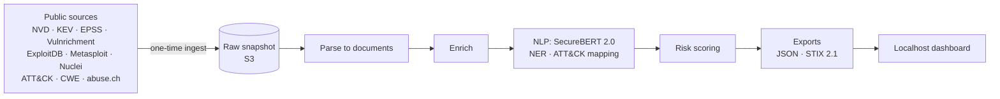

# Cyber Threat Intelligence System

A threat intelligence pipeline that collects vulnerability and indicator-of-compromise (IOC)
data from public sources, enriches and prioritizes it, and presents it in a local analyst
dashboard.

> **Status: in development.** The project is being built in phases. See the
> [build plan](tasks/todo.md) for scope and progress. Sections marked *planned* describe
> work that is not implemented yet.

## The problem

Security teams face tens of thousands of new CVEs and a constant stream of IOCs every
year. Severity scores alone don't say what to fix first: most "high" and "critical"
vulnerabilities are never exploited. This project answers a practical analyst question:
**which threats deserve attention first, and why?**

## What it does *(planned)*

- **Collects** CVEs (NVD), known-exploited vulnerabilities (CISA KEV), exploit-likelihood
  scores (FIRST EPSS), public exploits (ExploitDB), attacker techniques (MITRE ATT&CK),
  weakness types (MITRE CWE), CISA SSVC triage (Vulnrichment), weaponized exploits
  (Metasploit, Nuclei), and IOCs (abuse.ch ThreatFox and URLhaus), all in a single
  reproducible ingest.
- **Enriches** each CVE with exploit availability, KEV status, EPSS, CWE, and the content
  of its reference pages, fetched with an SSRF-safe scraper.
- **Understands text** with SecureBERT 2.0, a cybersecurity language model: extracts
  malware, products, and IOCs, and maps CVEs to ATT&CK techniques.
- **Prioritizes** vulnerabilities with a risk score validated against real-world
  exploitation, so the top tier is small and meaningful.
- **Presents** the results in a localhost Next.js dashboard and as STIX 2.1 output.

## Architecture *(planned)*



## Security skills and tools

| Area | Skills | Tools |
|---|---|---|
| Threat intelligence | CVE/KEV/EPSS analysis, IOC handling and defanging, MITRE ATT&CK mapping, STIX 2.1 | NVD, CISA KEV, FIRST EPSS, MITRE ATT&CK/CWE, abuse.ch |
| Vulnerability management | Risk-based prioritization, forward-looking evaluation | Python, pandas, scikit-learn |
| Secure engineering | SSRF defense, secrets management, least-privilege IAM, threat modeling (STRIDE) | httpx, pydantic, GitHub Actions, pip-audit, secret scanning |
| Cloud security | Private, encrypted, TLS-only storage; cost guardrails | AWS S3, IAM, AWS Budgets |
| NLP / ML | Security-domain NER and embeddings, risk modeling, baselines and ablations | SecureBERT 2.0, Hugging Face Transformers, scikit-learn |
| Visualization | Analyst dashboard | Next.js, TypeScript, Tailwind CSS |

## Design principles

- **Ingest once.** A single, auditable data pull. Everything downstream is reproducible
  from the stored snapshot without touching the network again.
- **Low cost.** S3 is the only cloud service; all compute runs locally.
- **Honest metrics.** Every reported number is produced by a script in this repo, next to
  the baselines it should beat.
- **Safe handling of malicious data.** IOCs are defanged, and the scraper refuses
  internal and cloud-metadata addresses.
- **Responsible data use.** Raw feed data is never redistributed; feed terms of use are
  respected.

## Setup

Requirements: Python 3.12+. Later phases add Node.js 20+ (dashboard), an AWS account
(S3 only), and a free abuse.ch Auth-Key.

```bash
python3 -m venv .venv && source .venv/bin/activate
pip install -c requirements.lock -e '.[dev]'
cp .env.example .env   # fill in values; .env is gitignored
pytest                 # offline: no network or AWS access needed
ruff check .
```

## Usage

```bash
cti probe                       # cheap check that every source is reachable / keys work
cti ingest --date 2026-10-25    # the one-time fetch into data/snapshots/<date>/
cti ingest --date 2026-10-25 --resume                       # continue after a failure
cti ingest --date 2026-10-25 --refetch kev --reason "..."   # logged, keeps old copy
cti status --date 2026-10-25    # manifest: files, sizes, pinned versions, refetches
cti parse  --date 2026-10-25    # offline: raw snapshot -> data/processed/<date>/*.jsonl.gz
```

## Project layout

```
src/cti/
  config.py          typed settings from CTI_* env vars; fail fast on missing values
  models.py          Document: the normalized record every source produces
  snapshot.py        immutable raw snapshot + manifest (ingest runs once)
  http/
    client.py        retrying HTTP client (429/5xx only, Retry-After aware)
    ratelimit.py     sliding-window rate limiter
    safe_fetch.py    SSRF-safe fetcher for untrusted URLs
  storage/           local, S3, and mirrored backends (no delete operation)
  sources/           one module per feed: fetch raw (network) + parse (offline)
  ingest.py, cli.py  one-time ingest orchestration and the `cti` command
  defang.py          make IOCs non-clickable (hxxp, [.])
tests/unit/          offline unit tests
vault/               design notes
tasks/todo.md        build plan and progress
```

## What this project demonstrates

- Turning raw threat feeds into **prioritized, explainable** intelligence.
- **Secure-by-design** engineering: SSRF protection, least-privilege cloud access, secret
  hygiene, and a documented threat model.
- **Measurement discipline**: risk scores evaluated against real exploitation outcomes,
  not assumed.
- Building **end to end**: ingestion, processing, cloud storage, evaluation, and UI.
