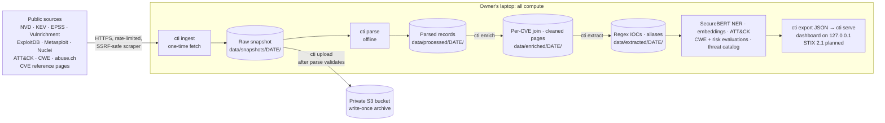
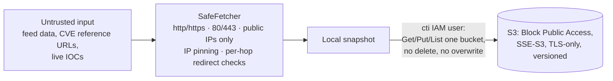

# Architecture

How the Cyber Threat Intelligence System is put together: what runs where, how data
moves, and where it is stored. The reasoning behind each choice is in
[decisions.md](decisions.md).

> Built: Phases 0–8 (ingest through the local dashboard), 10 (threat layer and the
> ATT&CK mapping re-test), 12 (the Known exploited view), and the 11a and 11c review fixes.
> Phase 9 (STIX 2.1, threat model, polish) is next. Stages marked *planned* are designed but not implemented yet. Progress: [`tasks/todo.md`](../tasks/todo.md).

## Overview



Three properties shape everything:

1. **The network is touched once.** `cti ingest` is the only command that downloads
   source data. Every later stage reads the stored snapshot. Two other commands download
   once, and neither result is uploaded to S3: `cti fetch-nvd-archive` (older NVD feeds,
   reference data for the ATT&CK re-test) and `cti models fetch` (model weights).
2. **All compute is local.** Parsing, NLP (SecureBERT 2.0 on CPU), and modeling run on
   one machine. There is no EC2, Lambda, or SageMaker.
3. **S3 is an archive, not a workspace.** It receives a write-once, checksummed copy of
   the finished raw snapshot and the gold set. No pipeline stage reads from it.

## Pipeline stages

| Stage | Command / module | Network | Input → output |
|---|---|---|---|
| Probe | `cti probe` | yes (cheap) | Checks each source is reachable and keys work |
| Ingest | `cti ingest` → `ingest.py`, `sources/*.fetch` | yes | Sources → raw snapshot + manifest |
| Status | `cti status` | no | Prints the manifest: files, sizes, pinned versions, refetches |
| Parse | `cti parse` → `sources/*.parse` | no | Raw snapshot → `Document` / `CveSignal` records (`.jsonl.gz`) |
| Upload | `cti upload` → `upload.py` | S3 only | Raw snapshot + gold set → S3, write-once |
| Enrich | Phase 4 | no | `cti enrich`: one record per CVE joining KEV, EPSS, ExploitDB, Metasploit, Nuclei, Vulnrichment, CWE names and pillars, and reference-link types; point-in-time features kept apart from snapshot-time context. Cleans reference pages (trafilatura boilerplate removal; pages with no content without JavaScript or a login, and PDFs, flagged and kept out of the corpus) |
| Extract | `cti extract` → `nlp/` | no | Cleaned pages + NVD descriptions → regex IOCs (offsets, defanged values, `origin` tag) and alias mentions normalized to ATT&CK IDs; `cti extract-eval` scores precision on a labelled review sample and recall on the gold set |
| ATT&CK grading | `cti attack-eval` → `nlp/attack_eval.py` | no | CVE text → ranked ATT&CK techniques, graded on MITRE CTID's KEV mappings (pinned copy in `data/reference/ctid/`); majority, TF-IDF, SecureBERT bi-encoder, and label prior + similarity |
| NLP | `cti models` / `ner` / `ner-eval` / `embed` → `nlp/models.py`, `ner.py`, `embed.py`, `semantic.py` | `models fetch` only (once) | SecureBERT 2.0 on CPU: NER over reference pages (entities linked to ATT&CK/ThreatFox names), bi-encoder embeddings of every NVD description with a KEV-language flag. Models pinned by commit and weight SHA-256, loaded offline |
| Classify + evaluate | `cti cwe-eval` → `nlp/cwe_config.py`, `nlp/cwe_eval.py` | no | NVD descriptions → 118 CWE classes (human labels with assigner kept), time split, pre-registered choices; majority, TF-IDF + LR, SecureBERT embeddings + LR, nearest centroid; plus one circular gold-set row |
| Risk evaluation | `cti risk-eval` → `nlp/risk_config.py`, `nlp/risk_eval.py` | no | Pre-registered rolling-origin KEV prediction: logistic model vs EPSS, SSVC and CVSS baselines, rank-based tiers |
| NVD archive | `cti fetch-nvd-archive` → `sources/nvd.py` (`NVDArchiveSource`) | yes (once) | NVD yearly feeds 2002–2022 → `data/reference-snapshots/<date>/` (same manifest and checks as the main snapshot; not in the ingest registry; never uploaded) |
| ATT&CK re-test | `cti attack-eval2` → `nlp/attack2_config.py`, `nlp/attack_data.py`, `nlp/attack_eval2.py` | no | Pre-registered re-test of CVE → ATT&CK ranking on a CVE-disjoint set (CTID `attack_to_cve`), trained on the CTID KEV mappings; text from the main snapshot plus the NVD archive; adds a CWE → CAPEC → ATT&CK chain and a CVSS rule |
| Export | `cti export` → `dashboard/export.py`, `dashboard/schema.py` | no | The pre-registered model refit on all labelled windows ranks the snapshot → schema-validated JSON (schema version 2) in `data/export/<date>/`: `meta` (dates, versions, input hashes, disclosures), `risk` (ranked CVEs, tiers, per-signal contributions), `iocs` (defanged IOCs, feed aggregates), `graphs` (CWE/ATT&CK/shared-host), `eval` (evaluation summaries), `threats` (if `cti threats` has run), `kev` (every KEV CVE in the fixed patch-first order, with `priority_rank` and a `why` line), `cves` (NVD cards for referenced CVEs that no other file details) |
| Threat review sheets | `cti threats-sheet` → `threats/review.py` | no | ThreatFox family counts → a blank category sheet of the top 34 named families in `data/reference/`; `--priority` appends families from the priority top 20 |
| Threats | `cti threats` → `threats/config.py`, `threats/catalog.py` | no | ThreatFox families → categories (review sheet, else pinned MISP galaxy), ATT&CK software and techniques, CVE links (reference pages, ThreatFox tags, ATT&CK text), and a pre-declared priority → `data/threats/<date>/threats.json`; writes the link review sheet and reads it back once filled. Reads `risk.json` for tiers, so it runs after `cti export`, and `cti export` runs again to include it. Never feeds the risk score |
| Serve | `cti serve` → `dashboard/serve.py` | loopback only | Built dashboard + export over HTTP on 127.0.0.1: exact-match file allowlist, Host-header check, strict CSP and security headers |
| Dashboard | `web/` (Vite + React + TypeScript) | no | Nine views over the exported JSON (incl. Known exploited: every KEV CVE in a fixed patch-first order), hand-rolled SVG charts and graphs; CI builds it against `web/fixtures/` and loads every view in headless Chrome under the CSP |
| STIX *(planned)* | Phase 9 | no | STIX 2.1 export |

Every source module has two halves: `fetch(ctx)` writes raw bytes to the snapshot
(network), and `parse(snapshot)` turns them into records (offline). A parser bug is fixed
by re-running `cti parse`, never by re-downloading.

## Storage

| Location | Contents | Mutability |
|---|---|---|
| `data/snapshots/<date>/` (local) | Raw source responses, gzip'd, plus `manifest.json` | Write-once; only the manifest is rewritten |
| `data/processed/<date>/` (local) | Parsed records, one `.jsonl.gz` per source | Regenerated freely from the snapshot |
| `data/enriched/<date>/` (local) | `cves.jsonl.gz`, `references.jsonl.gz`, and a `*-summary.json` for each | Regenerated freely (cves from processed records, references from the raw snapshot); never uploaded |
| `data/extracted/<date>/` (local) | `iocs`, `aliases`, `entities` (`.jsonl.gz` + `*-summary.json`; values defanged), `nvd-embeddings.npy` (float16) + `nvd-embeddings-index` | Regenerated freely; never uploaded |
| `~/.cache/huggingface/` (local) | SecureBERT 2.0 weights at pinned revisions | Fetched once; SHA-256 checked on every load |
| `data/eval/<date>/` (local) | Evaluation outputs (aggregates) and review sheets (defanged context) | Regenerated freely; never uploaded |
| `data/reference/` (in git) | Pinned third-party files, each with a `NOTICE.md`: CTID KEV → ATT&CK mappings and `attack_to_cve` (`ctid/`), CAPEC 3.9 (`capec/`), nine trimmed MISP galaxy clusters (`misp-galaxy/`). Review sheets: IOC review labels (document ID, span, y/n; no feed content), threat category labels and threat ↔ CVE link reviews (`threat-categories-<date>.csv`, `threat-links-<date>.csv`) | Committed; third-party SHA-256s pinned in code (`cti.reference.PINNED`, `attack_eval.CTID_SHA256`) and checked on every read |
| `data/reference-snapshots/<date>/` (local) | NVD 2002–2022 yearly feeds + manifest, from `cti fetch-nvd-archive` | Write-once like a snapshot; never uploaded |
| `data/threats/<date>/` (local) | `threats.json` from `cti threats` | Regenerated freely; never uploaded |
| `data/gold/gold.jsonl.gz` (local) | Frozen evaluation gold set | Frozen; SHA-256 committed in `cti/gold.py` |
| S3 `snapshots/<date>/…` | Copy of the raw snapshot | Write-once, enforced by code **and** IAM |
| S3 `gold/` | Copy of the gold set | Write-once |

Snapshot key layout (same locally and in S3):

```
<snapshot_id>/manifest.json
<snapshot_id>/raw/<source>/<attempt>/<file>
```

- The manifest records, per file: source, URL (secrets redacted), fetch time, size,
  SHA-256, and the source version (e.g. ATT&CK v20.0, EPSS model version).
- `attempt` increases only through a logged `--refetch <source> --reason …`; older
  attempts are kept, so the history of a source is never lost.
- The storage layer (`storage/`) has no delete operation. Writes use no-overwrite by
  default (S3 `If-None-Match: *`); retrying with identical bytes is accepted, different
  bytes are rejected.
- `data/` is gitignored except `data/reference/`. Raw feed data never enters the public
  repo (licensing).

## Point-in-time data

Risk scoring is evaluated forward-looking: score CVEs with data known at a **cutoff**
(snapshot − 180 days), then check which were added to CISA KEV after it. Three earlier
cutoffs (each a further 180 days back) support a rolling-origin evaluation. So the
snapshot holds a copy of each time-sensitive source per cutoff, plus the snapshot copy:

| Source | Cutoff copy | Snapshot copy |
|---|---|---|
| EPSS | Dated daily file | Dated daily file |
| ExploitDB | GitLab first-parent commit at cutoff | Current |
| Metasploit, Nuclei, Vulnrichment | Git first-parent commit at cutoff | Current |
| KEV | `dateAdded` splits before/after | Full catalog |

Leakage rules (fields that would reveal KEV status) are enforced at parse time. The
enriched per-CVE record then keeps point-in-time `signals[<as_of>]` apart from
`context_snapshot` (NVD status, scores, CWEs, reference lists as known at the snapshot).
NVD analyzes KEV-listed CVEs first, so those NVD fields are biased toward the label: all
17 forward positives at the latest cutoff are "Analyzed" vs about half of other CVEs. Details:
`vault/point-in-time-pinning.md`, `vault/risk-scoring-design.md`.

## Security boundaries



- **Untrusted URLs.** Reference URLs come from public CVE records, so the scraper
  validates every hop and connects to the validated IP to defeat DNS rebinding and SSRF
  (`http/safe_fetch.py`, `vault/ssrf-safe-fetching.md`). robots.txt is honored.
- **Malicious content.** IOCs are defanged for display (`hxxp://evil[.]com`); the gold set
  keeps unmodified text privately because entity offsets index into it.
- **Secrets.** Typed settings from `CTI_*` env vars; keys are `SecretStr`; the abuse.ch
  key (which must go in the URL path) is redacted from manifests and errors.
- **Cloud.** One private bucket; a dedicated `cti` IAM user that cannot delete and cannot
  PUT without `If-None-Match` (except the manifest, which the code replaces only
  by a compare-and-swap `If-Match` write). AWS Budgets alert at $5/month.
  Setup: [`infra/README.md`](../infra/README.md).
- **Supply chain.** Hash-pinned dependencies (`requirements.lock`, installed with
  `--require-hashes`), pip-audit, gitleaks, GitHub Actions pinned by commit SHA, and
  checkouts that keep no Git credentials (`persist-credentials: false`) in CI.

## Code map

```
src/cti/
  cli.py             `cti` command: subcommands for the stages in the table above, plus
                     upload and gold-import
  config.py          typed settings from CTI_* env vars; fail fast on missing values
  models.py          Document: the normalized record every source produces
  ingest.py          one-time ingest: per-source isolation, resume, logged refetch
  snapshot.py        raw snapshot + manifest, write-once
  upload.py          finished snapshot → S3, checksum-verified
  enrich/            offline per-CVE join (cves.py), CWE lookup (cwe.py), page cleaning
                     (cleaner.py, references.py)
  sources/           one module per feed (fetch + parse); registry.py sets ingest order
  nlp/               regex IOCs and aliases, SecureBERT models / NER / embeddings, and the
                     pre-registered evaluations: ATT&CK (attack_eval, attack_eval2), CWE,
                     risk (each with a *_config.py fixed before scoring)
  threats/           threat catalog: config.py (pre-declared rules), review.py (review
                     sheets), catalog.py (categories, ATT&CK, CVE links, priority)
  dashboard/         export.py (dashboard JSON), schema.py (its pydantic contract),
                     serve.py (loopback server)
  reference.py       pinned third-party files in data/reference/ (SHA-256 checked on read)
  references/        reference-link classifier, target selection, scraper, HTML→text
  http/              retrying client, rate limiter, SSRF-safe fetcher
  storage/           LocalStorage, S3Storage, MirroredStorage (no delete)
  gold.py            frozen, checksummed gold set
  defang.py          IOC defanging
```

Module-level detail: `vault/code-layout.md`.
