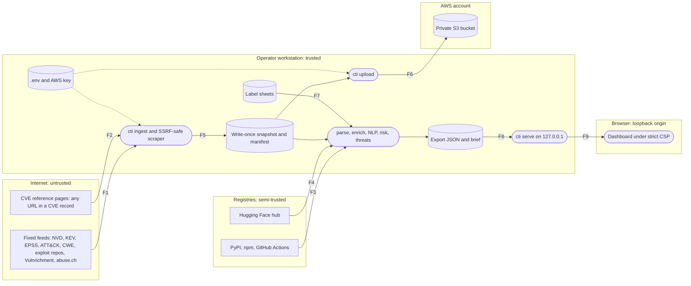

# Threat Model

A STRIDE threat model of the CTI pipeline: what it protects, who would attack it, where
untrusted data and code cross into it, what is already built against each threat, and
what risk is left. It follows the four-question framework (Shostack; OWASP Threat
Modeling Cheat Sheet) and applies STRIDE to each data flow that crosses a trust boundary.

Reviewed 2026-11-07 against `main` at `d30f012` plus the two fixes made with it (R4, R6).
Controls are cited as `file::symbol` or by test name, never by line number:
`tests/unit/test_threat_model_refs.py` fails if a cited file, symbol or test disappears,
so this document can't silently go stale. ATT&CK IDs are checked against ATT&CK v20 (the
snapshot's bundle is v20.0; v20.1 was current on the review date). The CTID KEV mappings
the pipeline uses for evaluation are on ATT&CK 16.1, a separate matter.

**Top risks**, by residual risk (details below):

1. **Poisoned or wrong threat context** (T5). One ThreatFox tag or one reference page
   can link a family to a CVE, and the link reviews were made by Claude for the owner.
   Links reorder threat families but never change a CVE's risk rank; abuse.ch data never
   trains a model; and the review is published with its precision (judged from evidence,
   25 of 43 links correct, 95% CI 43–72%).
2. **A long-lived cloud key that can rewrite the manifest** (T8, T9). Least privilege
   blocks deletes and overwrites of raw data, but the key has no MFA or expiry, the
   manifest it may replace is unsigned, and there is no data-event log to show misuse.
3. **A compromised dependency** (T12). Hash-pinned locks stop a swapped file, not a
   malicious release that was already pinned.

The highest *inherent* risk, a hostile reference page attacking the scraper, parsers and
dashboard (T1–T3, T6), is mitigated by controls that CI tests on every run.

## 1. What are we working on?

A single-operator Python pipeline on a workstation. It pulls 11 public feeds once, scrapes
up to 2,000 CVE reference pages, stores a write-once snapshot locally and in a private S3
bucket, runs local NLP models, and serves a read-only dashboard on 127.0.0.1.
Architecture: [architecture.md](architecture.md).

**Assets**

| Asset | Class | Why it matters |
|---|---|---|
| AWS access key (`~/.aws/credentials`), abuse.ch Auth-Key and GitHub token (`.env`) | Secret | Write access to the archive; account abuse. The abuse.ch key sits in a URL path; the GitHub token is optional and needs only public read access (it raises API rate limits) |
| Raw snapshot, manifest and gold set (local and S3) | Internal, hazardous: holds live malicious URLs and indicators | Every result derives from it; tampering silently changes all outputs |
| abuse.ch-derived data | Licence-restricted | Terms allow aggregates and family names only, never redistribution or training |
| Model weights (Hugging Face cache) | Integrity-critical | Loaded into the Python process |
| Python and npm dependencies, GitHub Actions | Integrity-critical | Run with the operator's or CI's privileges |
| Label sheets (`data/reference/*.csv`) | Integrity-critical | Steer threat categories and link reviews |
| Dashboard export and brief | Public (TLP:CLEAR) | What an analyst acts on; must not mislead or carry live indicators |

**Data flow and trust boundaries**

CI is a second, smaller boundary: it runs on every pull request with
`permissions: contents: read`, Actions pinned by commit SHA and `persist-credentials:
false`, and holds no cloud credentials (`.github/workflows/ci.yml`).

**Assumptions and scope**

- One trusted operator on a workstation that is not already compromised. Another local
  user matters only for the loopback server (T13).
- The AWS account root and the operator's admin user are secured outside this project.
- Feeds are public, so keeping feed data secret is not a goal; integrity and the
  abuse.ch licence terms are.
- Out of scope: physical access; the host OS and browser themselves; upstream feed
  availability; repudiation by the operator (a single operator, no CloudTrail data
  events: see R7); and the live AWS configuration. That configuration is in `infra/` and
  was verified once on 2026-10-26; re-check it read-only with `aws s3api
  get-bucket-policy`, `get-public-access-block` and `get-bucket-lifecycle-configuration`
  on the bucket (no cost beyond request pricing).

## 2. What can go wrong?

**Attacker profiles**

| ID | Who | Reaches the pipeline through |
|---|---|---|
| A1 | Malicious feed contributor: a ThreatFox or URLhaus reporter, or whoever adds a reference to a CVE record | Feed content (F1) and reference URLs (F2) |
| A2 | Operator of a hostile or compromised reference page, or a network attacker on its path | HTTP responses to the scraper (F2), then the parsers and the dashboard (F8, F9) |
| A3 | Upstream supply-chain attacker | A package, an Action or a model (F3, F4) |
| A4 | Credential thief | A key on disk, in a log or in an error message |
| A5 | Hostile web origin in the operator's browser | DNS rebinding or cross-origin requests to `cti serve` (F9) |
| A6 | Not an adversary: integrity risk from LLM-assisted labelling and from operator error, including feed text that reached the labelling session | The label sheets (F7), the repository and the export |

**Rating key.** Likelihood: **H**, attacker-controlled input reaches the element on every
normal run; **M**, it needs one realistic precondition (a compromised upstream, an
operator mistake, a leaked key); **L**, it needs host compromise or an AWS-side failure.
For residual risk only, **R** (remote): it needs defeating a control that CI tests on
every run. Impact: **H**, credential exposure, code execution, silent loss of integrity
in the published numbers, or AWS data loss or spend; **M**, wrong or missing data that
the checks or the operator would catch; **L**, a local DoS or an aborted run fixed by a
rerun. Risk = likelihood × impact from this grid:

| Likelihood \ Impact | L | M | H |
|---|---|---|---|
| H | M | H | H |
| M | L | M | H |
| L | L | L | M |
| R (residual only) | L | L | L |

*Inherent* is the risk without the listed controls; *residual* is what remains with them.
A residual risk is Low only through an R likelihood (a tested control) or a low impact,
and the controls list names which.

| ID | Flow | By | STRIDE | Threat | Weakness / technique | Inherent → residual | Decision |
|---|---|---|---|---|---|---|---|
| T1 | F2 | A1, A2 | I, E | A crafted reference URL or redirect reaches cloud metadata, localhost or an internal range | CWE-918, CAPEC-664 | H·H = **H** → R·H = **L** | Mitigated |
| T2 | F2 | A2 | T | A redirect downgrades to plain HTTP, so a network attacker can alter the page, or leads to a path robots.txt disallows | CWE-319 | H·M = **H** → R·M = **L** | Mitigated |
| T3 | F2 | A2 | D | A hostile page exhausts memory or time: huge body, compression bomb, slow drip, pathological HTML | CWE-400, CWE-409 | H·L = **M** → L·L = **L** | Mitigated; R5 |
| T4 | F1 | A1, A3 | D, E | A feed file carries an XML entity bomb or XXE, or an oversized download or archive member | CWE-611, CWE-776 (mitigated); CWE-770 (R3) | M·H = **H** → R·H = **L** | Mitigated; R3 |
| T5 | F1, F2, F7 | A1, A6 | T | Planted references, tags or labels inflate or bury a CVE or a threat family in what the analyst sees | Feed and label poisoning (no single CWE fits) | H·M = **H** → M·M = **M** | Accepted with disclosure (R9) |
| T6 | F8, F9 | A1, A2 | T, E | Feed or page text with script or markup runs in the dashboard | CWE-79 | H·H = **H** → R·H = **L** | Mitigated |
| T7 | F8, F9 | A1 | E | An analyst copies or clicks a live malicious indicator | Unsafe display of indicators (no single CWE fits) | H·M = **H** → R·M = **L** | Mitigated; R8 |
| T8 | F5, F6 | A4 | T | Snapshot bytes or the S3 archive are altered so results change silently | ATT&CK T1565.001 | M·H = **H** → L·H = **M** | Accepted (R1) |
| T9 | F6 | A4 | S, I | The AWS key is stolen and used to read or alter the archive | ATT&CK T1552.001, T1078.004, T1530 | M·H = **H** → L·H = **M** | Accepted (R2, R7) |
| T10 | F1 | A4 | I | An API key leaks into logs, errors or recorded URLs | CWE-532 | M·H = **H** → R·H = **L** | Mitigated (R6 fixed here) |
| T11 | F4 | A3 | T, E | A tampered model, or a pickle payload, runs code when the model loads | ATLAS AML.T0010.003; CWE-502 (mitigated) | M·H = **H** → R·H = **L** | Mitigated |
| T12 | F3 | A3 | T, E | A compromised Python or npm package, or an Action, runs on install, import or in CI | ATT&CK T1195.001; CWE-494, CWE-829 | M·H = **H** → L·H = **M** | Accepted (R10) |
| T13 | F9 | A5 | S, I | A web page rebinds DNS to reach the dashboard, or another local user reads it | CWE-346 | M·M = **M** → R·M = **L** | Mitigated; R11 |
| T14 | F5, F7 | A6 | R, T | Nobody can show who fetched, re-fetched or relabelled what, or a label sheet changes unnoticed | Missing audit trail | M·M = **M** → R·M = **L** | Mitigated in part (R4 fixed here); R7 |
| T15 | F7, F8 | A6 | I | Licence-restricted or hazardous data (raw abuse.ch rows, live indicators, gold-set text) leaks through the public repository or the export | CWE-200 | M·H = **H** → R·H = **L** | Mitigated |

**Controls and evidence**

- **T1:** every hop resolved and rejected unless all its addresses are public; the
  connection is pinned to the checked IP, with Host and SNI kept; proxy variables ignored;
  no keep-alive. `src/cti/http/safe_fetch.py::is_public_ip`, `SafeFetcher.validate`.
  Tests: `test_non_public_ips_rejected`, `test_redirect_to_internal_address_blocked`,
  `test_connects_to_pinned_ip_with_host_header_and_sni`,
  `test_client_ignores_env_proxies_and_keepalive`. D3FEND: D3-OTF (Outbound Traffic
  Filtering).
- **T2:** https→http refused on every hop; robots.txt checked for each hop before it is
  requested. `src/cti/http/safe_fetch.py::SafeFetcher.fetch`,
  `src/cti/references/scraper.py::scrape_one`. Tests:
  `test_https_to_http_redirect_refused`, `test_downgrade_refused_on_a_later_hop`,
  `test_intermediate_redirect_hop_robots_checked`.
- **T3:** a 2 MB body cap with `Accept-Encoding: identity` (no compressed responses); a
  15 s timeout on each network operation and a 30 s deadline on reading the body, checked
  per chunk; at most 3 redirects; the HTML parser never sees more than that body (lxml
  runs without network access); one bad page never aborts the run.
  `src/cti/http/safe_fetch.py::SafeFetcher`, `src/cti/enrich/cleaner.py::MAX_HTML_BYTES`.
  Tests: `test_body_size_capped`, `test_redirect_loop_capped`,
  `test_malformed_hosts_never_abort_the_scrape`. Residual L·L: no CPU limit on the HTML
  parser (R5), but a stuck page only stalls an offline run.
- **T4:** feed XML is parsed with defusedxml (no XXE, no entity expansion); downloads to
  file are capped at 2 GiB; Vulnrichment archive members over 5 MiB are skipped.
  `src/cti/sources/cwe.py`, `src/cti/nlp/attack_data.py`,
  `src/cti/sources/base.py::MAX_DOWNLOAD_BYTES`,
  `src/cti/sources/vulnrichment.py::MAX_MEMBER_BYTES`. Test:
  `test_cwe_rejects_entity_expansion` (the size caps are not tested; R3).
- **T5:** KEV, a curated authoritative list, is the only label source; abuse.ch data never
  trains a model; threat priority is a rule declared before it ran; links reviewed as
  wrong are dropped; threats never change a CVE's risk rank; every link names its source
  and the review method and precision are published. `src/cti/gold.py::trainable`.
  Tests: `test_trainable_drops_abusech_records`,
  `test_only_listed_modules_read_abusech_feeds`. Residual M·M: a wrong but unrejected
  link still reaches the analyst, labelled with its source.
- **T6:** strict CSP with Trusted Types, no inline code and `'self'` only; all text
  rendered as text; a build check bans `innerHTML`, `eval` and data-driven `href`.
  `src/cti/dashboard/serve.py::CSP`, `web/scripts/check.mjs`. Test:
  `test_serves_the_allowlist_with_security_headers`; CI also loads every view in headless
  Chrome under the real CSP.
- **T7:** indicators defanged in Python and checked again at export, which fails closed;
  never rendered as links. `src/cti/dashboard/export.py::check_defanged`, `defang_text`,
  `src/cti/defang.py`. Tests: `test_defang_url`, `test_threatfox_defangs_and_redacts_key`.
- **T8:** the snapshot is write-once and every read re-checks its SHA-256; S3 writes
  require `If-None-Match`; the code replaces the manifest only by compare-and-swap
  (`If-Match`); IAM denies deletes and every overwrite except of manifests.
  `src/cti/snapshot.py::Snapshot.read_raw`, `src/cti/storage/s3.py::S3Storage.replace`,
  `infra/cti-user-policy.json`. Tests: `test_cannot_overwrite_raw_data`,
  `test_checksum_verified_on_read`, `test_s3_replace_uses_if_match`,
  `test_manifest_replace_refuses_a_concurrent_change`. Residual L·H: the IAM policy is
  configuration, not a test, and a stolen key may still replace an unsigned manifest
  without `If-Match` (R1).
- **T9:** a dedicated IAM user limited to one bucket, with no deletes or overwrites (so a
  wrong bucket name in `cti upload` is refused too); the key is deactivated between uses;
  a TLS-only bucket policy; no secrets in the repository, and gitleaks in CI.
  `infra/cti-user-policy.json`, `infra/bucket-policy.json`, `.github/workflows/ci.yml`.
  Residual L·H: configuration-only controls and a long-lived key (R2, R7).
- **T10:** keys are `SecretStr`; recorded URLs and error text are redacted in raw and
  percent-encoded form; httpx drops `Authorization` on cross-origin redirects (checked in
  httpx's code); key-bearing loggers stay at WARNING even with `-v`.
  `src/cti/sources/base.py::FetchContext.redact`, `src/cti/config.py::Settings`,
  `src/cti/cli.py::NOISY_LOGGERS`. Tests: `test_key_redacted_from_http_errors`,
  `test_failure_is_isolated_redacted_and_resumable`, `test_reads_env_and_hides_secrets`,
  `test_verbose_keeps_key_bearing_loggers_quiet`.
- **T11:** pinned revision; only JSON and safetensors files fetched; the SHA-256 of every
  file re-checked on each load; offline loading; no remote code.
  `src/cti/nlp/models.py::verify`, `load_encoder`. Test:
  `test_models_verify_rejects_unpinned_weights`.
- **T12:** Python installs only from hash-pinned locks; npm with exact pins, no install
  scripts, a 14-day minimum package age and signature checks; pip-audit and npm audit;
  Actions pinned by SHA without persisted credentials. `requirements.lock`, `web/.npmrc`,
  `.github/workflows/ci.yml`. Residual L·H: a malicious release pinned before it was
  known is not caught by hashes (R10).
- **T13:** bound to 127.0.0.1 only; the Host header must name the loopback and this port;
  an exact-match file allowlist (the built dashboard and the export, never the snapshot);
  GET and HEAD only; error bodies never echo the request.
  `src/cti/dashboard/serve.py::check_loopback`, `allowlist`. Tests:
  `test_host_header_must_be_loopback_and_this_port`,
  `test_refuses_to_bind_anywhere_but_loopback`, `test_anything_off_the_allowlist_is_404`.
- **T14:** the manifest records each file's URL, SHA-256, time and source version;
  refetches need a logged reason; outputs record the config SHA-256 and git state, and
  the git state counts uncommitted edits to the label sheets; the labeller is disclosed in
  the export. `src/cti/snapshot.py::Snapshot`, `src/cti/cli.py::_git_state`. Tests:
  `test_refetch_is_logged_and_keeps_old_data`,
  `test_git_state_sees_edited_label_sheets_but_not_docs`.
- **T15:** `data/` is git-ignored except the pinned third-party reference files (trimmed of
  victim data and onion links) and the owner's label sheets; gitleaks scans every pull
  request and push to `main`; only listed modules may read
  abuse.ch feeds, and the export carries abuse.ch data only as counts and family names;
  every exported indicator is defanged; `cti serve` never serves the snapshot.
  `src/cti/reference.py::trim_misp_cluster`, `src/cti/dashboard/serve.py::allowlist`.
  Tests: `test_trim_misp_cluster_drops_victim_data_and_onion_links`,
  `test_every_committed_reference_file_is_pinned`,
  `test_only_listed_modules_read_abusech_feeds`, `test_anything_off_the_allowlist_is_404`.

## 3. What are we going to do about it?

| ID | Residual risk | Decision |
|---|---|---|
| R1 | The manifest is replaceable and unsigned; noncurrent S3 versions expire after 30 days (`infra/lifecycle.json`) | **Accept** for a single-operator archive with one ingest. Trigger: if the archive is shared, sign manifests and keep versions under Object Lock |
| R2 | A long-lived IAM user key, no MFA | **Accept**, with the key inactive between uploads. Trigger: any further AWS use moves to short-lived role credentials |
| R3 | Some in-memory reads have no size cap (`src/cti/sources/base.py::FetchContext.download`, `get_json`, and gzip re-reads), nor does the Vulnrichment archive in total | **Planned**: cap them like `src/cti/sources/base.py::copy_capped`. Low urgency: fixed feed URLs, and the gzip files are our own recompression |
| R4 | Label sheets are not hash-pinned in the threats output | **Partly fixed here**: `src/cti/cli.py::_git_state` now marks an export dirty if a sheet has uncommitted edits, and the commit pins committed ones. Hashing them into the threats output is deferred: it changes the export and the committed brief |
| R5 | No CPU or time limit on the HTML parser within the 2 MB body | **Accept**: one page at a time, offline, run by the operator |
| R6 | `cti -v` set the root logger to DEBUG, and botocore then logged the access-key ID and signing data (not the secret) | **Fixed here**: botocore, boto3, s3transfer and urllib3 stay at WARNING (`test_verbose_keeps_key_bearing_loggers_quiet`) |
| R7 | No CloudTrail data events or S3 access logs; the manifest records no operator | **Accept** to keep AWS cost near zero. Trigger: a shared archive |
| R8 | Description text keeps names the defanger doesn't recognise; text-only rendering is enforced by a build check | **Accept**: the CSP and Trusted Types still block execution |
| R9 | Threat context can be wrong (T5); labels were made by Claude on the owner's behalf | **Accept with disclosure**: the review method and precision are published in the export and the brief |
| R10 | No minimum package age on PyPI | **Accept**: hash pins mean no release arrives unnoticed; pip-audit runs in CI |
| R11 | `cti serve` has no authentication and unbounded threads; any local user can read the export | **Accept**: public-derived data on a single-user workstation |
| R12 | The IOC regexes run on attacker-controlled text and have not been tested for catastrophic backtracking (CWE-1333) | **Planned**: add worst-case timing tests |
| R13 | The scraper fetches up to 2,000 URLs chosen by whoever edits CVE records | **Accept**: each goes through the T1–T3 controls, robots.txt and a per-host delay |

## 4. Did we do a good job?

- **Tested controls:** T1, T2, T3, T4 (XML only), T5 (licence guard), T6, T7, T8 (code
  side), T10, T11, T13, T14 and T15 are backed by the unit tests named above; CI runs
  them on Python 3.12 and 3.14, with the dashboard's build checks and a headless-Chrome
  run of every view under the real CSP.
- **Configuration-only controls:** the IAM and bucket policies, Block Public Access,
  encryption, versioning and the budget alarm are in `infra/` and were verified live once
  (2026-10-26), not by tests; so are the dependency pins enforced by CI.
- **Not verified here:** whether the AWS key is inactive right now, the download and
  archive size caps (R3), the HTML parser's behaviour on pathological input (R5), and the
  regexes' worst case (R12).
- **Review again** when a source, a network path or a cloud service is added, when the
  archive is shared, or when a residual risk's trigger is met.
